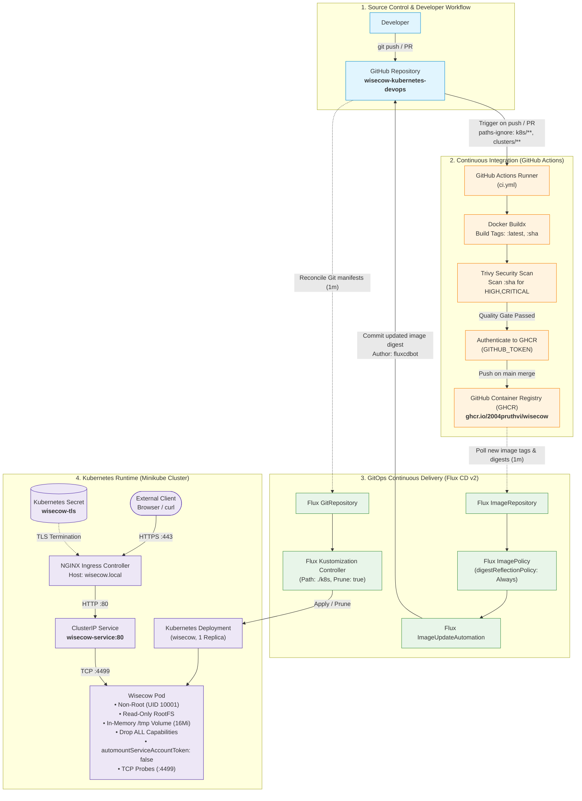
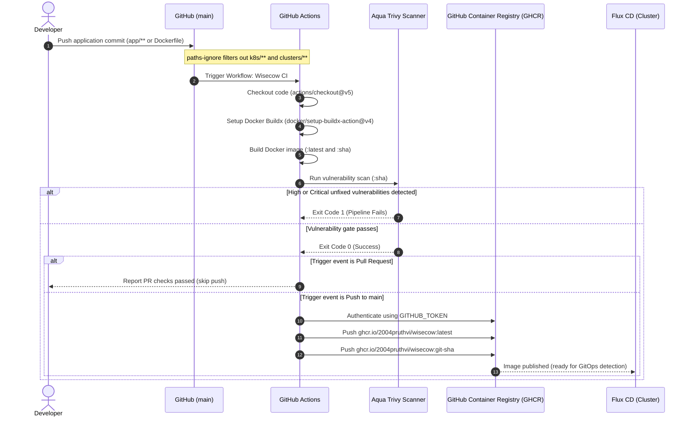

# Wisecow: Cloud-Native DevOps Deployment

[](https://kubernetes.io/)
[](https://fluxcd.io/)
[](https://github.com/features/actions)
[](https://trivy.dev/)
[](https://ghcr.io)
[](./app/LICENSE)

> A production-grade, declarative GitOps and containerization pipeline delivering a hardened microservice on Kubernetes with automated vulnerability gates, continuous delivery reconciliation, automated image digest updates, and TLS-terminated Ingress routing.

**Repository URL:** [https://github.com/2004Pruthvi/wisecow-kubernetes-devops](https://github.com/2004Pruthvi/wisecow-kubernetes-devops)  
**Project Status:** Active / Validated on local Minikube cluster with Flux CD v2 GitOps synchronization and GitHub Actions CI.

---

## Table of Contents

- [Project Overview](#project-overview)
- [System Architecture](#system-architecture)
- [Technology Stack](#technology-stack)
- [Repository Structure](#repository-structure)
- [Application Containerization](#application-containerization)
- [Kubernetes Deployment & Workload Design](#kubernetes-deployment--workload-design)
- [CI/CD Pipeline with Security Scanning](#cicd-pipeline-with-security-scanning)
- [Container and Kubernetes Security](#container-and-kubernetes-security)
- [GitOps with Flux CD](#gitops-with-flux-cd)
- [HTTPS and Ingress Configuration](#https-and-ingress-configuration)
- [Installation and Deployment Guide](#installation-and-deployment-guide)
- [Verification and Observability](#verification-and-observability)
- [Engineering Challenges and Solutions](#engineering-challenges-and-solutions)
- [Problem Statement 2 – Linux System Monitoring and Application Health Automation](#problem-statement-2--linux-system-monitoring-and-application-health-automation)
- [Skills Demonstrated](#skills-demonstrated)
- [Future Improvements](#future-improvements)
- [Author and Contact](#author-and-contact)

---

## Project Overview

### What Wisecow Does
Wisecow is a lightweight shell-based microservice that serves dynamic ASCII art wisdom over HTTP. When a client sends an HTTP request, the application samples a fortune cookie quote via `fortune`, wraps the text inside an ASCII cow speech bubble using `cowsay`, and streams an HTTP 200 response back to the client via a persistent `netcat` loop on port `4499`.

### DevOps Problem Statement
Legacy scripts and monolithic utilities typically suffer from several operational and security limitations:
- **Environment Inconsistency:** Dependencies (`fortune-mod`, `cowsay`, `netcat-openbsd`) vary across distributions and host systems.
- **Root Execution Risks:** Simple shell servers are frequently executed directly as `root`, creating severe host compromise vulnerabilities upon code execution.
- **Manual Operational Burden:** Deployment, restarts, and rollouts are manual and error-prone without orchestration or automated self-healing.
- **Configuration Drift:** Imperative deployments via manual scripts diverge over time from source control.
- **Unchecked Supply Chain:** Container images deployed without automated vulnerability scanning risk introducing critical CVEs into runtime clusters.

### Solution and Value Delivered
This project modernizes the Wisecow application by engineering a declarative, cloud-native operational lifecycle:
1. **Hardened Containerization:** Encapsulating application logic into a minimal `debian:bookworm-slim` container executed strictly under an unprivileged UID (`10001`).
2. **Automated Security Gates:** Integrating Aqua Security's **Trivy** in GitHub Actions to block builds containing unfixed `HIGH` or `CRITICAL` vulnerabilities.
3. **Declarative GitOps Continuous Delivery:** Employing **Flux CD v2** to reconcile Kubernetes manifests from Git and automatically track, reflect, and commit mutable image digests (`latest@sha256:...`) back to Git without manual intervention.
4. **Defense-in-Depth Kubernetes Hardening:** Enforcing read-only root filesystems, dropping all Linux kernel capabilities, isolating temporary FIFO runtime communication to an in-memory `emptyDir`, and disabling default ServiceAccount token automounts.
5. **Secure Traffic Management:** Providing host-based routing and TLS termination via NGINX Ingress Controller.

### Key Learnings
- Balancing container runtime immutability (`readOnlyRootFilesystem: true`) with stateful UNIX primitives (FIFOs created via `mkfifo`).
- Breaking infinite CI/CD feedback loops caused by GitOps automated manifest write-backs through targeted path filtering (`paths-ignore`).
- Tracking and deploying immutable SHA256 image digests for continuously updated mutable tags (`latest`) in Flux CD.

---

## System Architecture

The following diagram illustrates the complete end-to-end lifecycle, from developer commit to Kubernetes cluster reconciliation and external HTTPS client access.



---

## Technology Stack

| Category | Technology | Purpose in Project |
| :--- | :--- | :--- |
| **Application Runtime** | Bash 5+, `fortune-mod`, `cowsay`, `netcat-openbsd` | Lightweight shell application generating ASCII fortune responses over an HTTP socket. |
| **Containerization** | Docker, `debian:bookworm-slim` | Minimal base OS containerization, packaging application binaries with non-root security contexts. |
| **CI Engine** | GitHub Actions (`ci.yml`) | Automated build, multi-tagging, Trivy vulnerability scanning, and container registry publishing. |
| **Vulnerability Scanning** | Aqua Security Trivy | Shift-left container security gate checking OS packages and libraries for unfixed `HIGH` and `CRITICAL` vulnerabilities. |
| **Container Registry** | GitHub Container Registry (GHCR) | Secure OCI-compliant registry hosting tagged images (`:latest`, `:${{ github.sha }}`). |
| **Orchestration** | Kubernetes (v1.30+), Kustomize | Declarative workload management, resource boundaries, health probes, and manifest templating. |
| **GitOps Engine** | Flux CD v2 | Automated Git reconciliation, cluster drift correction, image repository polling, and automated manifest write-backs. |
| **Ingress & TLS** | NGINX Ingress Controller, OpenSSL | Host-based traffic routing (`wisecow.local`) and TLS encryption termination via Kubernetes TLS secret. |
| **Environment** | Minikube | Local single-node Kubernetes development cluster providing realistic cloud-native operational simulation. |

---

## Repository Structure

```text
wisecow-kubernetes-devops/
├── .github/
│   └── workflows/
│       └── ci.yml               # Automated CI workflow: Docker buildx, Trivy scan, GHCR push
├── app/
│   ├── LICENSE                  # Application open-source license (BSD 3-Clause)
│   ├── README.md                # Original problem statement and prompt reference
│   └── wisecow.sh               # Core application script (netcat HTTP loop and cowsay generator)
├── clusters/
│   └── minikube/
│       ├── gitrepository.yaml   # Flux GitRepository: Polls Git repo every 1m
│       ├── image-policy.yaml    # Flux ImagePolicy: Filters :latest and tracks SHA256 digests
│       ├── image-repository.yaml# Flux ImageRepository: Scans GHCR every 1m for updated tags
│       ├── image-update-automation.yaml # Flux ImageUpdateAutomation: Commits updated digests to Git
│       └── wisecow-app.yaml     # Flux Kustomization: Reconciles ./k8s manifests into the cluster
├── k8s/
│   ├── deployment.yaml          # Hardened Deployment with security contexts, probes, and resource limits
│   ├── ingress.yaml             # NGINX Ingress resource routing wisecow.local with TLS termination
│   ├── kustomization.yaml       # Kustomize manifest aggregating deployment, service, and ingress
│   └── service.yaml             # Kubernetes ClusterIP Service exposing port 80 -> container port 4499
├── scripts/
│   ├── application-health-checker.sh # HTTP/HTTPS application availability checker with TLS validation
│   └── system-health-monitor.sh      # Linux host health monitor: CPU, RAM, Disk, and Process tracking
├── .gitignore                   # Excludes certificates (.crt, .key), environment files, and temporary pipes
├── Dockerfile                   # Hardened Debian Bookworm Slim Dockerfile executing as non-root UID 10001
└── README.md                    # Comprehensive enterprise DevOps project documentation
```

### Purpose of Core Directories
- **`app/`**: Contains the source code of the Wisecow application and its license.
- **`k8s/`**: Contains pure, declarative Kubernetes manifests defining the desired runtime state of the workload, bundled together via Kustomize.
- **`clusters/minikube/`**: Contains Flux CD custom resources that drive the GitOps continuous delivery lifecycle and automated image updates.
- **`scripts/`**: Houses standalone Linux automation and monitoring scripts for host health checks and synthetic HTTP/HTTPS application probes.
- **`.github/workflows/`**: Houses the GitHub Actions workflow definition for continuous integration and automated vulnerability gating.

---

## Application Containerization

### Dockerfile Architecture
The container image is built using `debian:bookworm-slim` to minimize the attack surface and eliminate unnecessary host binaries while retaining required utilities (`fortune-mod`, `cowsay`, and `netcat-openbsd`).

```dockerfile
FROM debian:bookworm-slim

RUN apt-get update && apt-get install -y --no-install-recommends \
    bash \
    netcat-openbsd \
    fortune-mod \
    fortunes-min \
    cowsay \
    ca-certificates \
    && rm -rf /var/lib/apt/lists/*

ENV PATH="/usr/games:${PATH}"

RUN useradd --system --uid 10001 --create-home wisecow

WORKDIR /app

COPY --chown=wisecow:wisecow app/wisecow.sh /app/wisecow.sh

RUN chmod 755 /app/wisecow.sh && \
    chown wisecow:wisecow /app

USER 10001

EXPOSE 4499

CMD ["/bin/bash", "/app/wisecow.sh"]
```

### Key Engineering Decisions
- **Minimal Dependencies (`--no-install-recommends`):** Installs strictly the necessary binaries and clears package indices (`/var/lib/apt/lists/*`) in the same layer to keep the image compact and reduce vulnerability surface.
- **Debian Games PATH Configuration:** On Debian systems, `cowsay` and `fortune` are located in `/usr/games`. Explicitly injecting `ENV PATH="/usr/games:${PATH}"` guarantees that unprivileged shells can resolve these executables without path failures.
- **Dedicated Non-Root User:** Creates a system user and group (`wisecow`, UID/GID `10001`) with explicit home directory permissions, transitioning away from root before container runtime (`USER 10001`).
- **File Ownership & Execution Permissions:** The script `/app/wisecow.sh` is copied with ownership `wisecow:wisecow` and execution mode `755`.

### Local Docker Build & Execution

1. **Build the container image:**
   ```bash
   docker build -t wisecow:local .
   ```

2. **Run the container as an unprivileged process:**
   ```bash
   docker run -d \
     --name wisecow-local \
     -p 4499:4499 \
     --read-only \
     --tmpfs /tmp:rw,noexec,nosuid,size=16m \
     wisecow:local
   ```

3. **Verify the application response:**
   ```bash
   curl http://localhost:4499
   ```

4. **Verify non-root user execution inside container:**
   ```bash
   docker exec wisecow-local id
   # Output: uid=10001(wisecow) gid=10001(wisecow) groups=10001(wisecow)
   ```

---

## Kubernetes Deployment & Workload Design

The application is deployed using declarative Kubernetes resources located in the [`k8s/`](file:///c:/Users/pruth/Downloads/wisecow-kubernetes-devops/k8s) directory.

### Manifest Breakdown

#### 1. Deployment (`k8s/deployment.yaml`)
- **Replica Management:** Configured with `replicas: 1`. As this project is validated in a local Minikube environment, a single replica demonstrates functional reconciliation and rolling updates without consuming excessive host resources. Horizontal Pod Autoscaling (HPA) is documented under [Future Improvements](#future-improvements).
- **ServiceAccount Hardening:** `automountServiceAccountToken: false` prevents Kubernetes from mounting the API credential token inside the pod, neutralizing credential exfiltration if a container process is breached.
- **Resource Boundaries:**
  - `requests`: CPU `100m`, Memory `64Mi` (ensures predictable cluster scheduling).
  - `limits`: CPU `250m`, Memory `128Mi` (prevents memory leaks or unbounded CPU consumption).
- **Health Probes:**
  - `readinessProbe`: `tcpSocket` on port `4499`, checking every 10 seconds with a 5-second initial delay. Guarantees that traffic is only routed once `netcat` is actively listening.
  - `livenessProbe`: `tcpSocket` on port `4499`, checking every 20 seconds with a 10-second initial delay. If the shell script or listener loop crashes or hangs, Kubernetes automatically restarts the container.
- **Temporary In-Memory Storage:** Mounts an `emptyDir` volume backed by RAM (`medium: Memory`, `sizeLimit: 16Mi`) at `/tmp`. This allows `wisecow.sh` to create its required named pipe (`/tmp/response`) while preserving `readOnlyRootFilesystem: true`.

#### 2. Service (`k8s/service.yaml`)
- Exposes the pod internally within the cluster via a `ClusterIP` Service named `wisecow-service`.
- Routes incoming TCP traffic on standard HTTP port `80` to target container port `4499` selected by label `app: wisecow`.

#### 3. Ingress (`k8s/ingress.yaml`)
- Uses the `nginx` Ingress class.
- Defines host-based routing for domain `wisecow.local`.
- Terminates TLS encryption at the cluster boundary using the secret `wisecow-tls`.
- Forwards root path (`/`) requests downstream to `wisecow-service:80`.

### End-to-End Traffic Flow

```text
Client (HTTPS https://wisecow.local:443)
       │
       ▼
NGINX Ingress Controller (Terminates TLS using Secret: wisecow-tls)
       │
       ▼ (HTTP unencrypted internal routing)
ClusterIP Service (wisecow-service:80)
       │
       ▼ (Kubernetes EndpointSlice proxying)
Wisecow Pod (Container Port 4499)
       │
       ▼
netcat loop reading /tmp/response FIFO --> cowsay + fortune response
```

### Manifest Deployment Commands

Apply manifests directly using Kustomize:
```bash
kubectl apply -k k8s/
```

Verify deployment status and resources:
```bash
kubectl get deployment wisecow
kubectl get pods -l app=wisecow -o wide
kubectl get svc wisecow-service
kubectl get ingress wisecow-ingress
```

---

## CI/CD Pipeline with Security Scanning

The Continuous Integration workflow is managed via GitHub Actions in [`.github/workflows/ci.yml`](file:///c:/Users/pruth/Downloads/wisecow-kubernetes-devops/.github/workflows/ci.yml).



### Pipeline Workflow Stages

1. **Trigger Configuration:**
   - Runs on `push` and `pull_request` targeting the `main` branch.
   - **Critical GitOps Rule:** Configured with `paths-ignore:` for `k8s/**` and `clusters/minikube/**`. This prevents automated GitOps manifest commits from triggering recursive CI builds.
2. **Minimal Permissions:**
   ```yaml
   permissions:
     contents: read
     packages: write
   ```
   Follows least-privilege principles by restricting the workflow to read repository code and write only to GitHub Packages/GHCR.
3. **Multi-Tag Container Build:**
   Uses `docker/setup-buildx-action@v4` to build two image tags:
   - `ghcr.io/2004pruthvi/wisecow:latest`
   - `ghcr.io/2004pruthvi/wisecow:${{ github.sha }}`
4. **Vulnerability Gating (Aqua Trivy):**
   Scans the built container image before publishing using `aquasecurity/trivy-action@v0.36.0`:
   ```yaml
   - name: Scan Docker image with Trivy
     uses: aquasecurity/trivy-action@v0.36.0
     with:
       image-ref: ${{ env.IMAGE_NAME }}:${{ github.sha }}
       format: table
       exit-code: '1'
       ignore-unfixed: true
       vuln-type: 'os,library'
       severity: 'CRITICAL,HIGH'
   ```
   - `exit-code: '1'`: Fails the CI job immediately if any qualifying vulnerability is detected.
   - `ignore-unfixed: true`: Prevents build failures on upstream CVEs that do not yet have vendor patches.
5. **Registry Authentication & Publishing:**
   - Conditioned strictly on `github.event_name == 'push'` to ensure unmerged pull requests do not publish artifacts.
   - Authenticates to `ghcr.io` using the built-in `${{ secrets.GITHUB_TOKEN }}`.
   - Pushes both `:latest` and the immutable `:${{ github.sha }}` tags.

---

## Container and Kubernetes Security

Security controls are implemented across multiple layers according to the defense-in-depth model.

| Layer | Security Control | Configuration | Purpose & Impact |
| :--- | :--- | :--- | :--- |
| **Image** | **Non-Root Execution** | `USER 10001` (Dockerfile) | Prevents container processes from executing as `root` (UID 0), restricting privileges to user space. |
| **Pod** | **RunAsNonRoot Enforcement** | `runAsNonRoot: true` | Causes the kubelet to reject pod scheduling if the container attempts to run as UID 0. |
| **Pod** | **Explicit User / Group UID** | `runAsUser: 10001`<br/>`runAsGroup: 10001`<br/>`fsGroup: 10001` | Enforces deterministic POSIX ownership for processes and mounted volumes. |
| **Pod** | **Default Seccomp Profile** | `seccompProfile: { type: RuntimeDefault }` | Restricts system calls to the container runtime's default secure whitelist, blocking high-risk syscalls. |
| **Pod** | **Disable API Token Automount** | `automountServiceAccountToken: false` | Prevents the default ServiceAccount secret token from being mounted inside `/var/run/secrets/kubernetes.io/serviceaccount`, mitigating cluster lateral movement. |
| **Container** | **Prevent Privilege Escalation** | `allowPrivilegeEscalation: false` | Ensures child processes cannot acquire more privileges than their parent process (e.g., via setuid binaries). |
| **Container** | **Read-Only Root Filesystem** | `readOnlyRootFilesystem: true` | Blocks attackers or malware from modifying runtime binaries, installing tools, or altering configuration files. |
| **Container** | **Drop All Linux Capabilities** | `capabilities: drop: ["ALL"]` | Strips all Linux kernel capabilities (including `CAP_NET_RAW` and `CAP_SYS_ADMIN`), restricting the process to unprivileged user operations. |
| **Storage** | **Ephemeral Memory Volume** | `emptyDir: { medium: Memory, sizeLimit: 16Mi }` | Mounts an in-memory scratch space to `/tmp` so the named pipe (`mkfifo`) functions without writable disk permissions. |
| **Supply Chain**| **Automated Vulnerability Scan** | Trivy (`exit-code: '1'`, `CRITICAL,HIGH`) | Blocks image publishing in CI whenever unmitigated high or critical CVEs are present in OS or library dependencies. |
| **Repository** | **Secret Hygiene** | `.gitignore` rules for `*.key`, `*.pem`, `*.crt` | Prevents accidental leakage of TLS private keys, certificates, or tokens into public Git history. |

> [!NOTE]
> **Security Disclaimer:** Security hardening controls minimize attack surfaces and adhere to industry benchmarks (CIS Kubernetes / NIST SP 800-190). They reduce exposure significantly but do not guarantee complete immunity from zero-day vulnerabilities or runtime exploits.

---

## GitOps with Flux CD

Continuous Delivery is managed natively via **Flux CD v2** using declarative manifests in [`clusters/minikube/`](file:///c:/Users/pruth/Downloads/wisecow-kubernetes-devops/clusters/minikube).

### GitOps Components

1. **`GitRepository` (`clusters/minikube/gitrepository.yaml`):**
   - References source repository: `https://github.com/2004Pruthvi/wisecow-kubernetes-devops`.
   - Polls the `main` branch every `1m` using authentication secret `wisecow-git-auth`.
2. **`Kustomization` (`clusters/minikube/wisecow-app.yaml`):**
   - Directs Flux to reconcile manifests from `./k8s` into the `default` namespace every `5m`.
   - `prune: true`: Automatically deletes resources from the cluster when they are removed from Git, ensuring drift correction.
3. **`ImageRepository` (`clusters/minikube/image-repository.yaml`):**
   - Continuously scans `ghcr.io/2004pruthvi/wisecow` every `1m` to detect new image tags and metadata.
4. **`ImagePolicy` (`clusters/minikube/image-policy.yaml`):**
   - Filters tags using regex `pattern: '^latest$'`.
   - Configured with `digestReflectionPolicy: Always`. Because `latest` is a mutable tag, this policy instructs Flux to detect and extract the underlying SHA256 digest whenever the tag is republished.
5. **`ImageUpdateAutomation` (`clusters/minikube/image-update-automation.yaml`):**
   - Configured with `strategy: Setters`.
   - Scans `./k8s/deployment.yaml` for the setter marker:
     ```yaml
     image: ghcr.io/2004pruthvi/wisecow:latest@sha256:... # {"$imagepolicy": "flux-system:wisecow"}
     ```
   - Automatically commits updated digests back to Git as user `fluxcdbot <fluxcdbot@users.noreply.github.com>` with a structured commit message containing the digest diff, then pushes the commit back to `main`.

### Automated Continuous Delivery Flow

```text
1. Developer pushes code to main
2. GitHub Actions builds image and pushes to GHCR
3. Flux ImageRepository discovers updated digest for tag :latest
4. Flux ImagePolicy evaluates digest change (digestReflectionPolicy: Always)
5. Flux ImageUpdateAutomation updates k8s/deployment.yaml with new SHA256 pin
6. Flux commits and pushes change back to GitHub main
7. Flux GitRepository detects new commit
8. Flux Kustomization controller reconciles updated deployment in Minikube
```

---

## HTTPS and Ingress Configuration

### Ingress Architecture
External HTTP/HTTPS access is managed through the **NGINX Ingress Controller**, utilizing host-based routing mapped to `wisecow.local`.

- **Ingress Resource:** Defined in [`k8s/ingress.yaml`](file:///c:/Users/pruth/Downloads/wisecow-kubernetes-devops/k8s/ingress.yaml).
- **Ingress Class:** `nginx`.
- **Host Route:** `wisecow.local` -> routes path `/` to `wisecow-service:80`.
- **TLS Termination:** The Ingress controller terminates TLS using the certificate and private key stored in the Kubernetes secret `wisecow-tls`.

### Certificate Scope: Local vs. Production
> [!IMPORTANT]
> The TLS certificate used in this implementation is a **self-signed X.509 certificate** generated via OpenSSL for local validation, testing, and staging demonstration within Minikube.  
> It is **not** a publicly trusted certificate from a public Certificate Authority. In a production cloud Kubernetes environment, certificate issuance should be automated using **cert-manager** integrated with Let's Encrypt or an enterprise PKI via ACME HTTP-01 / DNS-01 challenges.

---

## Installation and Deployment Guide

### Prerequisites
- **Git** (v2.30+)
- **Minikube** (v1.30+)
- **kubectl** (v1.28+)
- **Docker** (v24.0+, required for local image builds)
- **OpenSSL** (for generating the local TLS certificate)
- **Flux CLI** (v2.0+, optional for inspecting GitOps status)

---

### Step 1: Clone the Repository
```bash
git clone https://github.com/2004Pruthvi/wisecow-kubernetes-devops.git
cd wisecow-kubernetes-devops
```

---

### Step 2: Start Minikube & Enable Addons
Start Minikube with sufficient resources and enable the NGINX Ingress controller addon:
```bash
minikube start --cpus=2 --memory=4096 --driver=docker
minikube addons enable ingress
```

Verify that the Ingress controller pods are running:
```bash
kubectl get pods -n ingress-nginx -w
```

---

### Step 3: Generate TLS Certificate & Kubernetes Secret
Generate a self-signed TLS certificate and private key for `wisecow.local`:
```bash
openssl req -x509 -nodes -days 365 -newkey rsa:2048 \
  -keyout tls.key \
  -out tls.crt \
  -subj "/CN=wisecow.local/O=Wisecow"
```

Create the Kubernetes TLS secret in the `default` namespace:
```bash
kubectl create secret tls wisecow-tls \
  --cert=tls.crt \
  --key=tls.key
```

*Note: The generated `tls.key` and `tls.crt` are automatically ignored by Git via `.gitignore`.*

---

### Step 4: Deploy the Workload

#### Option A: Direct Declarative Deployment (via Kustomize)
Deploy the deployment, service, and ingress manifests:
```bash
kubectl apply -k k8s/
```

#### Option B: Continuous Delivery via Flux CD (GitOps)
1. Install Flux controllers in your Minikube cluster:
   ```bash
   flux install
   ```
2. Create the Git authentication secret containing your GitHub Personal Access Token (PAT with `repo` permissions to allow image update commits):
   ```bash
   flux create secret git wisecow-git-auth \
     --url=https://github.com/2004Pruthvi/wisecow-kubernetes-devops \
     --username=git \
     --password=<YOUR_GITHUB_PAT>
   ```
3. Apply the Flux GitOps resources:
   ```bash
   kubectl apply -f clusters/minikube/gitrepository.yaml
   kubectl apply -f clusters/minikube/wisecow-app.yaml
   kubectl apply -f clusters/minikube/image-repository.yaml
   kubectl apply -f clusters/minikube/image-policy.yaml
   kubectl apply -f clusters/minikube/image-update-automation.yaml
   ```

---

### Step 5: Configure Local Hostname Resolution
Retrieve the Minikube cluster IP address:
```bash
minikube ip
```

Map `wisecow.local` to the Minikube IP address in your operating system's hosts file:
- **Linux / macOS:** Edit `/etc/hosts` (requires `sudo`):
  ```text
  <MINIKUBE_IP> wisecow.local
  ```
- **Windows:** Edit `C:\Windows\System32\drivers\etc\hosts` (as Administrator):
  ```text
  <MINIKUBE_IP> wisecow.local
  ```

---

### Step 6: Verify HTTP and HTTPS Access

Test HTTPS access using `curl` (use `-k` to accept the self-signed certificate):
```bash
curl -k https://wisecow.local
```

Alternatively, test HTTPS directly against the Minikube IP using SNI resolution:
```bash
curl -k --resolve wisecow.local:443:$(minikube ip) https://wisecow.local
```

Expected output: An HTTP 200 response with ASCII cowsay fortune output wrapped in HTML `<pre>` tags.

---

## Verification and Observability

### Workload Inspection Commands

Check pod execution status and assigned node:
```bash
kubectl get pods -l app=wisecow -o wide
```

Check the ClusterIP service configuration and endpoints:
```bash
kubectl get service wisecow-service
kubectl get endpointslices -l kubernetes.io/service-name=wisecow-service
```

Inspect Ingress routing and TLS status:
```bash
kubectl get ingress wisecow-ingress
kubectl describe ingress wisecow-ingress
```

Stream live application container logs:
```bash
kubectl logs -l app=wisecow -f
```

Inspect pod security and volume mounts:
```bash
kubectl describe pod -l app=wisecow
```

### Flux CD Status Commands

Verify Git repository source synchronization:
```bash
flux get sources git
```

Verify application Kustomization reconciliation:
```bash
flux get kustomizations
```

Inspect container image scanning and reflection status:
```bash
flux get images repository
flux get images policy
flux get images update
```

Manually trigger immediate Git repository reconciliation:
```bash
flux reconcile source git wisecow
flux reconcile kustomization wisecow
```

---

### Common Troubleshooting Scenarios

| Issue | Symptom | Root Cause | Remediation |
| :--- | :--- | :--- | :--- |
| **CrashLoopBackOff on Startup** | Pod restarts repeatedly; logs show `rm: cannot remove '/tmp/response': Read-only file system` | Root filesystem is set to read-only, but `/tmp` is missing the writable `emptyDir` mount. | Verify that `k8s/deployment.yaml` mounts volume `tmp` (`emptyDir: { medium: Memory }`) at `/tmp`. |
| **Ingress Returns 404 Not Found** | Ingress responds with default backend 404 error. | Request is sent without the matching `Host: wisecow.local` header, or Ingress addon is inactive. | Verify hostname resolution in `/etc/hosts` and confirm `minikube addons enable ingress` is active. |
| **Ingress Returns 503 Service Unavailable** | Ingress responds with HTTP 503. | Pod fails readiness probe (`tcpSocket: 4499`) or endpoints are unmapped. | Check `kubectl describe pod -l app=wisecow` for probe failures and verify `wisecow-service` selector matches `app: wisecow`. |
| **Flux Fails to Push Automated Commits** | Flux logs show `git push: authentication required` or `permission denied`. | Secret `wisecow-git-auth` is missing or the associated GitHub token lacks repository write permissions. | Recreate `wisecow-git-auth` using a GitHub Personal Access Token with read/write access to repository contents. |

---

## Engineering Challenges and Solutions

### 1. Read-Only Root Filesystem with Shell FIFO Named Pipe
- **Problem:** When hardening the Kubernetes container with `readOnlyRootFilesystem: true`, the container immediately entered `CrashLoopBackOff`. Logs revealed `mkfifo: cannot create fifo '/tmp/response': Read-only file system`.
- **Root Cause:** The shell server (`wisecow.sh`) uses `mkfifo /tmp/response` as an inter-process communication (IPC) channel between the `netcat` TCP listener and the request handler. Under a read-only rootfs, writing to `/tmp` is blocked at the kernel layer.
- **Solution:** Configured an in-memory `emptyDir` volume (`medium: Memory`, `sizeLimit: 16Mi`) mounted at `/tmp` in `k8s/deployment.yaml`.
- **Engineering Lesson:** Hardening container workloads requires analyzing application runtime I/O patterns. In-memory scratch volumes allow legacy applications requiring temporary files to run safely without granting disk persistence or writable root filesystem permissions.

### 2. Debian Games PATH Resolution for Non-Root Users
- **Problem:** The container failed its startup prerequisite checks (`Install prerequisites.`), exiting with status code `1` despite `fortune-mod` and `cowsay` being installed during the Docker build.
- **Root Cause:** On Debian Bookworm, `cowsay` and `fortune` are installed into `/usr/games`. When transitioning from root to non-root user `wisecow` (`UID 10001`), the default shell `PATH` did not include `/usr/games`.
- **Solution:** Added `ENV PATH="/usr/games:${PATH}"` to the Dockerfile and ensured directory ownership of `/app` belonged to `wisecow:wisecow`.
- **Engineering Lesson:** System package managers frequently install non-daemon utilities into non-standard binary directories. Base image auditing and environment variable declaration must accompany privilege reduction.

### 3. GitOps Image Update Infinite Feedback Loop
- **Problem:** After enabling Flux `ImageUpdateAutomation` to commit new image digests back to `k8s/deployment.yaml`, the repository entered an infinite CI/CD loop: Flux committed manifest updates to `main`, GitHub Actions detected the commit and triggered a new build, pushed a new image to GHCR, and Flux committed again.
- **Root Cause:** The GitHub Actions workflow trigger was listening to all `push` events on `main` without discriminating between application source code modifications and GitOps deployment manifest updates.
- **Solution:** Added `paths-ignore:` rules for `'k8s/**'` and `'clusters/minikube/**'` in `.github/workflows/ci.yml`.
- **Engineering Lesson:** In automated write-back GitOps architectures, CI pipelines must decouple application code triggers from declarative infrastructure triggers to preserve pipeline idempotency.

### 4. Git Authentication Boundaries for Automated Write-Backs
- **Problem:** Flux `ImageUpdateAutomation` reported errors when attempting to push updated image digests back to GitHub: `unable to push changes: permission denied`.
- **Root Cause:** Standard read-only deployment tokens or default cluster credentials allow Flux to pull manifests for reconciliation, but automated updates require write authorization to the repository branch.
- **Solution:** Created the dedicated Kubernetes Secret `wisecow-git-auth` using a GitHub Personal Access Token configured with fine-grained repository write permissions, attached to both `GitRepository` and `ImageUpdateAutomation`.
- **Engineering Lesson:** Operational automation requires explicit segmentation of Git permissions: read-only tokens for cluster state consumers, and tightly controlled write credentials for automated continuous delivery operators.

### 5. Automated Digest Tracking on Mutable `latest` Tags
- **Problem:** Tagging container images as `latest` causes Kubernetes nodes to skip pulling updated layers if `ImagePullPolicy: IfNotPresent` is set, leading to stale workload states.
- **Root Cause:** The mutable `latest` tag does not trigger Kubernetes Deployment updates unless the manifest specification itself changes.
- **Solution:** Configured Flux's `ImagePolicy` with `digestReflectionPolicy: Always` and pinned the image in `k8s/deployment.yaml` using Flux setters (`ghcr.io/2004pruthvi/wisecow:latest@sha256:...`).
- **Engineering Lesson:** Immutable cryptographic image digests (`@sha256:...`) eliminate caching ambiguity and guarantee deterministic deployments while still permitting automated continuous delivery.

---

# Problem Statement 2 – Linux System Monitoring and Application Health Automation

This section documents the implementation and validation of two standalone, dependency-free Bash automation scripts designed to solve critical operational challenges in infrastructure management: continuous host resource monitoring and synthetic application uptime validation.

---

## 1. Objective 1 – System Health Monitoring Script

**File:** [`scripts/system-health-monitor.sh`](./scripts/system-health-monitor.sh)

### Operational Context & Importance
In production DevOps and Site Reliability Engineering (SRE) environments, proactive host monitoring is crucial to prevent cascading service outages. Undetected memory leaks, runaway background processes, disk volume saturation, or CPU starvation can destabilize underlying container host nodes, cause Kubernetes nodes to transition to a `NotReady` state, and trigger widespread pod evictions. 

`system-health-monitor.sh` delivers immediate visibility into core system vitals and generates timestamped alert records without requiring complex, heavyweight third-party monitoring agents.

### Implemented Capabilities
- **CPU Utilization Monitoring:** Samples CPU idle time across two iterations using `top -bn2`, isolating the idle percentage and calculating exact CPU consumption (`100 - idle`) via `awk`.
- **Memory Utilization Monitoring:** Queries `free -m` for total and available system memory, computing active memory usage percentage (`((total-available)/total)*100`) via `awk`.
- **Disk Space Monitoring:** Evaluates root partition (`/`) utilization percentage via `df -P /`.
- **Process Count Monitoring:** Counts all active system processes using `ps -e --no-headers | wc -l`.
- **Configurable Alert Thresholds:** Evaluates sampled usage against configurable ceiling thresholds, logging normal status or raising high-priority `ALERT:` notifications.
- **Timestamped Persistent Logging:** Outputs health metrics to standard output while appending ISO-formatted timestamped records (`[YYYY-MM-DD HH:MM:SS]`) to a persistent log file using `tee -a`.

### Configuration & Thresholds
Alert thresholds and log destinations are defined as configurable environment variables directly at the beginning of [`scripts/system-health-monitor.sh`](./scripts/system-health-monitor.sh):

```bash
# Alert thresholds
CPU_THRESHOLD=80        # Alert when CPU usage exceeds 80%
MEMORY_THRESHOLD=80     # Alert when memory usage exceeds 80%
DISK_THRESHOLD=80       # Alert when disk usage exceeds 80%
PROCESS_THRESHOLD=300   # Alert when total running processes exceed 300

# Persistent log file destination
LOG_FILE="$HOME/system-health.log"
```

### Execution Command
Grant execute permissions and run the monitoring script:

```bash
chmod +x scripts/system-health-monitor.sh
./scripts/system-health-monitor.sh
```

### Representative Output
The following representative output was captured during host validation:

```text
========== SYSTEM HEALTH CHECK STARTED ==========
CPU Usage: 0.3%
CPU usage is normal: 0.3%
Memory Usage: 23.2%
Memory usage is normal: 23.2%
Disk Usage: 2%
Disk usage is normal: 2%
Running Processes: 30
Process count is normal: 30
========== SYSTEM HEALTH CHECK COMPLETED ==========
```

> [!NOTE]
> Actual metric values vary depending on the host machine specifications, operating system distribution, and active workload conditions.

### Validation & Testing Results
- **Bash Syntax Validation:** Passed static syntax validation without errors or warnings (`bash -n scripts/system-health-monitor.sh`).
- **Baseline Execution:** Executed successfully on the Linux host; verified that normal usage reports were generated for CPU, memory, disk, and process metrics.
- **Alert Trigger Simulation:** Verified alerting logic by temporarily configuring `CPU_THRESHOLD=0`. Upon execution, the script immediately generated the expected alert:
  ```text
  [2026-11-16 09:30:15] ALERT: High CPU usage: 0.3%
  ```
- **Threshold Restoration:** Confirmed that `CPU_THRESHOLD` was restored to its production baseline (`80`).
- **Log Verification:** Confirmed that `~/system-health.log` was created automatically and that all evaluation events were recorded with ISO-8601 timestamps.

---

## 2. Objective 2 – Application Health Checker

**File:** [`scripts/application-health-checker.sh`](./scripts/application-health-checker.sh)

### Operational Context & CI/CD Pipeline Integration
Host-level health does not guarantee application availability; a healthy server may host a crashed, deadlocked, or misconfigured application. The `application-health-checker.sh` script executes synthetic HTTP/HTTPS availability checks against any web service endpoint.

**Pipeline & Operational Integration:**
- **CI/CD Smoke Testing:** Can be integrated into deployment pipelines (e.g., GitHub Actions, GitLab CI, Jenkins) as an automated post-deployment verification gate. Because the script returns exit code `0` for `UP` and exit code `1` for `DOWN`, pipelines can automatically halt execution or trigger an automated rollback if the deployment fails health verification.
- **Synthetic Monitoring / Cron Health Probes:** Can be scheduled as a periodic Linux cron job (`* * * * *`) or integrated with alerting systems (Slack, PagerDuty, email webhooks) to continuously verify external service availability.

### Implemented Capabilities
- **Command-Line Argument Parsing:** Accepts the target application URL as an input argument (`$1`), validating input presence and displaying usage instructions if omitted:
  ```text
  Usage: ./scripts/application-health-checker.sh <application-url>
  ```
- **HTTP/HTTPS Probing via `curl`:** Executes non-blocking availability checks with `-L` (follows redirects), `-sS` (silent mode with error output), and `-o /dev/null` (discards response payloads).
- **HTTP Status Code Extraction:** Extracts the HTTP response status code via `-w "%{http_code}"`.
- **HTTP 2xx Success Detection:** Matches responses against regex `^2[0-9][0-9]$` (e.g., `200 OK`, `201 Created`, `204 No Content`) to classify the application as `UP`.
- **Failure & Timeout Detection:** Accurately classifies non-2xx responses (e.g., `404`, `500`, `502`, `503`) and connection dropouts/timeouts (status `000`) as `DOWN`.
- **Configurable Network Timeouts:** Enforces connection timeout and maximum transfer time limits via `TIMEOUT=10` (`--connect-timeout 10` and `--max-time 10`) to prevent hanging processes.
- **Default Strict TLS Verification:** Validates server TLS/SSL certificates against trusted Certificate Authorities by default (no insecure `-k` / `--insecure` flags).
- **Timestamped Persistent Logging:** Appends structured health records to `~/application-health.log`.
- **Deterministic Exit Codes:** Returns exit code `0` on successful `UP` status, and exit code `1` on `DOWN` status for automation compatibility.

### Execution Commands
Grant execute permissions and test endpoint availability:

```bash
chmod +x scripts/application-health-checker.sh

# Probe target endpoint
./scripts/application-health-checker.sh https://example.com
```

### Representative Output

#### Successful Probe (HTTP 200 OK)
```text
Application URL: https://example.com
Application Status: UP
Application is responding successfully (HTTP 200)
```

#### Failure Probe (Unreachable / Timeout / Non-2xx)
```text
Application URL: http://127.0.0.1:9999
Application Status: DOWN
Application is unreachable or request timed out
```

### Validation & Testing Results
- **Bash Syntax Verification:** Passed static syntax validation without errors (`bash -n scripts/application-health-checker.sh`).
- **Prerequisite Validation:** Verified availability and compatibility of `curl` on the host environment.
- **Public Trusted HTTPS Test:** Successfully probed public HTTPS endpoint (`https://example.com`), correctly classifying the service as `UP` with HTTP 200 and exit code `0`.
- **Unreachable Service Test:** Tested against non-existent local endpoint (`http://127.0.0.1:9999`), correctly detecting connection refusal, classifying the service as `DOWN`, and returning exit code `1`.
- **Strict TLS Rejection Test (Wisecow Minikube Endpoint):** Probed the local Wisecow deployment (`https://wisecow.local`). Because the local Minikube cluster utilizes an OpenSSL self-signed certificate rather than a public CA certificate, `curl` rejected the untrusted certificate and accurately reported the endpoint as `DOWN`, validating that default TLS security controls are actively enforced.
- **Log Verification:** Confirmed that all probe events and timestamps were accurately recorded in `~/application-health.log`.

> [!IMPORTANT]
> **Critical Security Note on TLS Verification:**  
> The script intentionally avoids passing the `-k` (`--insecure`) flag to `curl`. Disabling TLS certificate validation in production scripts introduces critical vulnerabilities, including exposure to Man-in-the-Middle (MITM) attacks and DNS spoofing. The verification failure on the local Wisecow endpoint is expected behavior because it uses an internal self-signed development certificate rather than a public Certificate Authority.

---

## 3. Automation Scripts Repository Structure

The automation scripts are located in the dedicated [`scripts/`](./scripts) directory within the repository:

```text
wisecow-kubernetes-devops/
├── scripts/
│   ├── system-health-monitor.sh       # Linux host resource monitor (CPU, Memory, Disk, Processes)
│   └── application-health-checker.sh  # HTTP/HTTPS availability & TLS uptime checker
├── app/                               # Wisecow microservice application code & prompt
├── k8s/                               # Kubernetes declarative workload & Ingress manifests
├── clusters/                          # Flux CD GitOps continuous delivery manifests
├── .github/                           # GitHub Actions CI/CD workflows
└── README.md                          # Project & operational documentation
```

---

## 4. Skills Demonstrated in Problem Statement 2

- **Linux System Administration:** Host resource inspection, process table management, filesystem space auditing, and unprivileged user execution.
- **Bash Scripting:** Clean POSIX/Bash syntax, modular functions, robust parameter handling, and `awk` string/numerical processing.
- **Process and Resource Monitoring:** Metrics collection from `/proc`, `top`, `free`, `df`, and `ps`.
- **HTTP/HTTPS Troubleshooting:** Synthetic transaction probing, redirect navigation (`-L`), and HTTP status code interpretation.
- **TLS Certificate Validation:** Strict SSL/TLS certificate checking, preventing insecure bypasses in production workflows.
- **Logging and Error Handling:** Timestamped event logging (`tee -a`), simultaneous stdout display, and input argument validation.
- **Exit-Code-Based Automation:** Deterministic binary exit statuses (`0` for success, `1` for failure) enabling seamless CI/CD pipeline integration.
- **Git and GitHub Version Control:** Git branch management, atomic commits, and repository organization.

---

## Skills Demonstrated

- **Linux Systems Engineering:** Bash scripting, process pipelines, named pipes (`mkfifo`), systemd/process signals, user/group privilege isolation (UID 10001).
- **System & Application Health Automation:** Host resource inspection (CPU, Memory, Disk, Processes), HTTP/HTTPS availability checking, TLS certificate validation, exit-code automation, timestamped logging (`~/system-health.log`, `~/application-health.log`).
- **Container Engineering:** Multi-stage Dockerfile design, minimal base images (`debian:bookworm-slim`), Docker Buildx, layer caching, non-root user execution.
- **Kubernetes Orchestration:** Deployments, ClusterIP Services, Ingress, Kustomize overlays, resource quotas (requests/limits), TCP liveness/readiness health probes.
- **GitOps & Continuous Delivery:** Flux CD v2 (`source-controller`, `kustomize-controller`, `image-reflector-controller`, `image-automation-controller`), automated Git reconciliation, automated manifest write-backs.
- **CI/CD Pipeline Automation:** GitHub Actions workflow design, least-privilege token permissions, multi-tag image creation, event-based workflow conditioning.
- **Cloud-Native Security:** Aqua Security Trivy container scanning, Kubernetes Pod Security Context (`runAsNonRoot`, `seccompProfile`), Container Security Context (`readOnlyRootFilesystem`, `drop: ALL` capabilities, `allowPrivilegeEscalation: false`), ServiceAccount token disabling, `.gitignore` secret management.
- **Networking & Ingress:** NGINX Ingress Controller, host-based routing, TLS termination, X.509 certificate creation with OpenSSL.

---

## Future Improvements

The following architectural enhancements represent planned extensions for cloud-scale production environments:

- [ ] **Automated Public TLS with cert-manager:** Integrate `cert-manager` with Let's Encrypt to automate issuance and renewal of publicly trusted SSL/TLS certificates via ACME HTTP-01 / DNS-01 challenges.
- [ ] **External Secrets Management:** Replace locally created Kubernetes secrets with **External Secrets Operator (ESO)** synchronized with HashiCorp Vault, AWS Secrets Manager, or Google Cloud Secret Manager.
- [ ] **Production Cloud Kubernetes Migration:** Provision managed Kubernetes clusters (e.g., AWS EKS, Google GKE, or Azure AKS) using Terraform / OpenTofu.
- [ ] **Horizontal Pod Autoscaling (HPA):** Deploy Kubernetes Metrics Server and configure an HPA resource to dynamically scale pod replicas based on CPU and memory utilization thresholds.
- [ ] **Observability Stack:** Deploy Prometheus and Grafana for metrics collection and visual dashboards, complemented by Fluent Bit / Loki for centralized log aggregation.
- [ ] **Policy Enforcement:** Enforce organization-wide Kubernetes governance using **Kyverno** or **OPA Gatekeeper** to reject non-compliant manifests before admission.
- [ ] **Supply Chain Security Attestation:** Implement **Cosign** (Sigstore) for cryptographic container image signing and SLSA provenance verification in the CI pipeline.

---

## Author and Contact

**Pruthvi Raj D S**  
DevOps & Cloud-Native Engineer  

- **GitHub:** [https://github.com/2004Pruthvi](https://github.com/2004Pruthvi)  
- **LinkedIn:** [https://www.linkedin.com/in/pruthvirajds/](https://www.linkedin.com/in/pruthvirajds/)  
- **Portfolio:** [https://pruthvi-raj-ds.vercel.app/](https://pruthvi-raj-ds.vercel.app/)  
- **Project Repository:** [https://github.com/2004Pruthvi/wisecow-kubernetes-devops](https://github.com/2004Pruthvi/wisecow-kubernetes-devops)  

*This project was engineered to demonstrate practical, production-ready DevOps principles—bridging secure application packaging, automated vulnerability gates, and closed-loop GitOps continuous delivery.*
